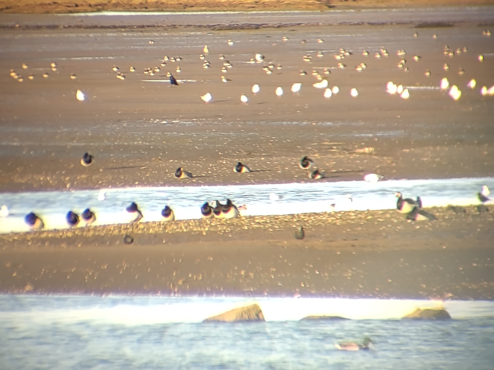

    

I didn't find a great deal of time the past two weeks for my own primary work; I spent a lot of time working with collaborators and students on their projects. Planning to return to my SDM work[^1] and KBA work[^2] in the next couple of weeks.

[^1]: The SDM project was last described in [this weeknote](20260831_weeknotes_2026_35).
[^2]: The KBA work was last described in [this weeknote](20260605_weeknotes_2026_23).

## What I was working on

- TEE: This summer I was supervising an intern, Louis Driver. He's writing up a paper on the [Tessera Embeddings Explorer](https://tee.cl.cam.ac.uk/). Last week I was working a bit on iterating this towards publication.
- Forest structural heterogeneity: My other intern, Ameer Alhashemi, is writing up a paper on using Tessera to measure the structural heterogeneity of forests, i.e., to see how well Tessera can reproduce the heterogeneity metrics derived from LiDAR observations. Ditto.
- Hinewai: In my last couple of weeknotes I described some work I've been doing with PhD student Nina de Jong on a paper about slow successional change on the Hinewai peninsula in New Zealand. I've developed a fun approach to quantify slow change in Landsat observations, but we've decided to save this and describe it in a future paper. For Nina's current paper we'll just use some simple stats to tell the basic story of the drivers behind successional change in her study area.
- Part II projects:[^3] I'm working with two undergrad students, whose projects started last week. For both of them, I spent quite a bit of time last week reading and doing some (pen and paper!) maths to formulate the projects. I discuss these further below.

[^3]: For reasons, third-year undergraduates in Cambridge are called Part II students.

## Part II projects

### Who Looks Where

This is a project I came up with a few months ago and advertised through my own department, Plant Sciences. Tim Bongaerts, third-year Natural Sciences student, has taken on the project.

The idea for the project is to take [GBIF](https://www.gbif.org/) / other citizen-sampled nature data and ask the question: what are the variables that drive sampling effort in citizen science?

It's a statistically thorny question. Do we have more observations at a given site because there is increased sampling effort or increased biodiversity? I've written up a methodology that disentangles the two under a number of simplifying assumptions. Tim will throw some data at it and see if it works.

### Geolocation Uncertainty

The idea for this project is that there are nicer ways we could be dealing with the (sometimes quite large!) geolocation uncertainty in GBIF data. For example, if we're using GBIF data to build species distribution models, we should build these models in such a way that the models are uncertainty-aware, and ideally propagate this uncertainty.

This is a project I didn't advertise, but I was chatting with [Prof. Anil Madhavapeddy](https://anil.recoil.org/) about it last week and mentioned that I had previously thought about advertising this project but didn't this time round. 12 hours later, Anil had a student on it! Finley Stirk, from computer sciences. 

Finley will be primarily supervised by my colleague [Michael Dales](https://digitalflapjack.com/), with me chipping in regularly. The idea is to look specifically at the GBIF-based habitat mapping that Michael and I are working on, and testing whether an improved treatment of uncertainty improves the maps. Anil also wrote up the project on [his blog](https://anil.recoil.org/ideas/tessera-gbif-uncertainty).

## Miscellanea

### Aberlady Bay

My wife and I take an annual autumn trip to Aberlady Bay in East Lothian, in the hope of seeing tens of thousands of pink-footed geese noisily arriving around dusk. This year we were perhaps a little too early in the year, and there were only a few dozen pink-footies. BUT, we managed to see a large gaggle of barnacle geese, precisely the species I had failed to find on [Islay two weeks earlier](20261013_weeknotes_2026_41)!

We were also delighted by an *enormous* flock of lapwings, the largest we had ever seen, putting on a murmuration-style display. Very bad photo (through my binocular lenses) with both sets of birds (barnacles and lapwings) below.

{fig-align="center" fig-alt="Photo of geese through binoculars" width="80%"}
