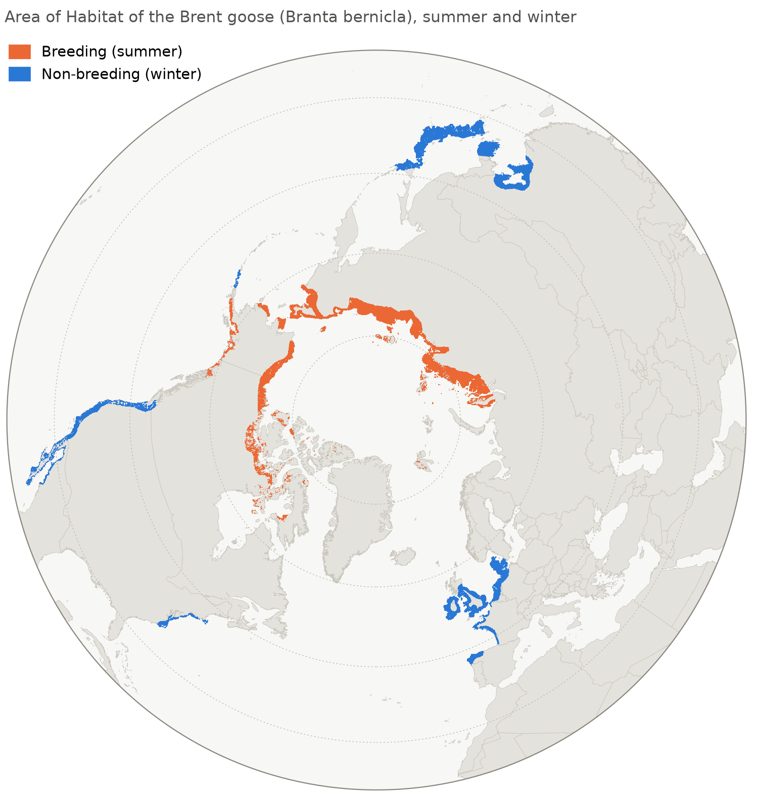
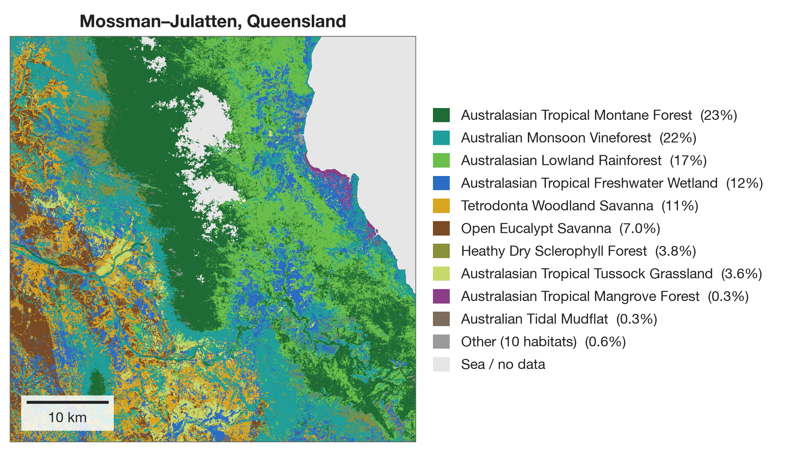
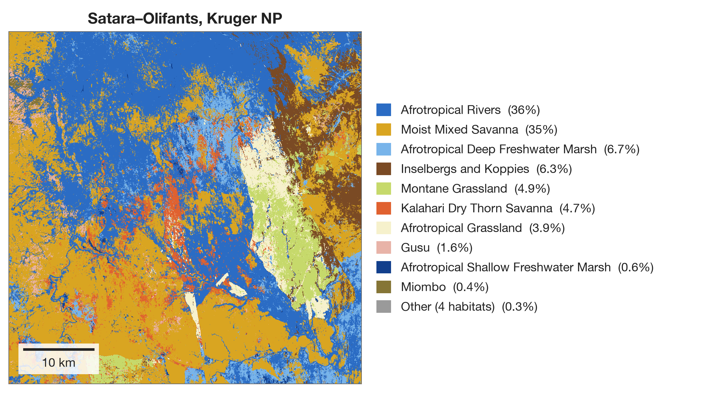
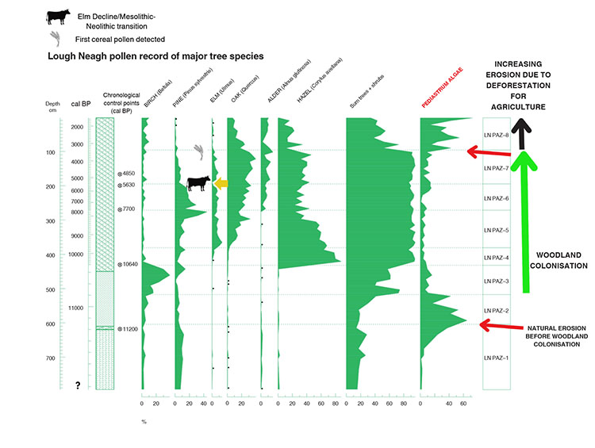
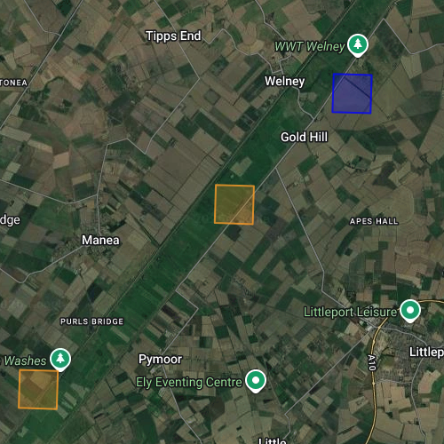

## KBAs

Last week I wrote up a planned methodology for my project building a new pipeline for longlisting potential [KBA](https://www.keybiodiversityareas.org/en) sites, and presented it to my colleagues Daniele Baisero and Andy Plumptre from the KBA programme. 

Subsequently, they've shared a collection Area of Habitat[^AOH] maps with me, spanning a huge number of species. I spent a bit of time last week just clicking through different species and marvelling at their geographic distributions. Pictured below is the AoH of the brent goose *(Branta bernicla)*. Like many geese, they lead a somewhat mad life summering in the high Arctic and wintering in Barrow-in-Furness. 

[^AOH]: *Area of Habitat:* the actual space within a given species' geographical range that contains suitable environmental conditions and habitat types for that species to inhabit. 

{fig-align="center" fig-alt="Map showing area of habitat of the brent goose." width="60%"}

In the coming weeks, I'm going to get going on implementing the first steps of my planned pipeline.

## Species Distribution Modelling

After a hiatus of a few weeks, I got going again on my project attempting species distribution modelling with Tessera. Few bits of progress here:

- I changed prediction strategy for the distribution models. Previously, each model would simply have a probability threshold (tuned using the held-out validation set). At inference time, the model would predict presences for all species with probabilities above the threshold, and absences otherwise. Now, I'm doing something slightly smarter: for *each survey plot* at inference time, I choose the number of species $k$ that is expected to maximise F1 accuracy for that specific plot. I then predict the presences for the top $k$ species by probability, and absences for everything else.
- I ran various additional ablation tests looking at supplementing Tessera with additional environmental data, trying different ML architectures, etc.

At this stage I think I have all I need to put things together for a first draft of a manuscript. I'll work on that this coming fortnight.

## Habitat Mapping

Another project I'm returning to after a long hiatus: mapping the [Habitats of the World](https://press.princeton.edu/series/habitats-of-the-world) with [eBird](https://ebird.org/home) data and [Tessera](https://geotessera.org/). This is conceptually quite similar to the habitat mapping project I'm working on with Michael Dales, although the differing habitat typology and species-habitat crosswalk leads to rather different methodologies. More importantly, this project isn't a full-fledged research project, just a quick proof of concept I'm working on for some collaborators.

 Last week, I had a quick and dirty first pass at two 50x50km habitat maps, one in northern Queensland, Australia and one in Kruger National Park, South Africa.[^mozambique]

[^mozambique]: Also a small sliver of Mozambique.

{fig-align="center" fig-alt="Image showing habitat map." width="80%"}

{fig-align="center" fig-alt="Image showing habitat map." width="80%"}

By my (admittedly inexpert) eye, the Australian map does a reasonably good job, while the African map does a rather poor job. I *think* this fundamentally comes down to the input bird observations: there aren't enough sufficiently informative checklists (i.e., checklists spotting strong indicators / obligates for certain habitats) to discriminate between some of the different habitats here, and so everything collapses to a few habitats, often the wrong ones.

I'm planning to do a bit of diagnosis this week before writing up a quick report for my collaborators.

## Various other bits

- I mentioned last week that I'm involved with two Part II projects: Tim Bongaerts is modelling [GBIF](https://www.gbif.org/what-is-gbif) sampling effort while Finley Stirk is trying to get his head aroung GBIF geolocation uncertainty. Both students have gotten going now and are already beginning to make progress.[^finley]
- Last week, following a suggestion from new PhD student Sophie Jones, I gave a mini-workshop about Tessera for the new PhD students at the CRI.

[^finley]: [Here](https://finleystirk.github.io/weeknotes/24-10-26.html) is Finley's first blogpost about the geolocation project.

## What I was reading

### Pollen Records of Lough Neagh

In October I've tried to get back into the habit of doing at least 30 minutes of (academic) reading every day. One quite fun thing I read last week was a recent paper by Chepstow-Lusty and Fossitt (2026).[^chepstow]

Looking at pollen records from Lough Neagh over the last centuries, the authors conclude that the times of the greatest algal content in the lough (i.e., the times of the worst eutrophication crises) coincided with times of diminished woodland cover surrounding the lough. We need to plant trees!

{fig-align="center" fig-alt="Figure showing species distributions within pollen records in Lough Neagh as a function of time." width="60%"}

[^chepstow]: [Chepstow-Lusty, A. & Fossitt, J. (2026). *Reconstructing the Woodland History Around Lough Neagh Before and After Major Human Impact—Can Large-Scale Catchment Restoration Mitigate the Eutrophication Crisis?*. Biology and Environment: Proceedings of the Royal Irish Academy.](https://muse.jhu.edu/pub/423/article/1001320)

### Clouds

Outside of the academic literature, I've recently started reading *The Cloudspotter's Guide* by Gavin Pretor-Pinney, founder of the [Cloud Appreciation Society](https://cloudappreciationsociety.org/). I'm reading this because I've long been acutely conscious that I'm woefully ignorant about how clouds work and how to read a clouded sky.[^cumulus]

[^cumulus]: So far, I've learned to identify cumulus. This is the "classic" cloud one sees in children's drawings. It's going to get harder, I believe.

The book opens by reproducing the Society's [manifesto](https://cloudappreciationsociety.org/manifesto/), which charmingly includes the line:

> We pledge to fight 'blue-sky thinking' wherever we find it.

## Miscellanea

### National Plant Monitoring Scheme

My wife and I have signed up as volunteers with the [National Plant Monitoring Scheme](https://www.npms.org.uk/). We've been assigned a 1km^2 grid square (a *monad*) in the Cambridgeshire Fens, pictured below. Over the coming years we'll visit it twice a year to perform surveys of indicator species.

{fig-align="center" fig-alt="Map showing location of NPMS grid square, overlaid on Google Satellite images." width="60%"}

As well as being fun, I have a professional motive here: if I'm going to be mapping British habitats from space, I want to really improve my understanding of what they look like on the ground. I know a decent number of plants, but I only have a very patchy understanding of how species assemblages relate to habitat classifications, and what "good" and "bad" habitat conditions look like.

Our grid square is quite an interesting one: most of it sits in the [Ouse Washes SSSI](https://en.wikipedia.org/wiki/Ouse_Washes): a seasonally flooded grassland.[^grassland] This is the diagonal linear feature visible in the satellite image above. We should find some quite interesting aquatic plants here. We drove out to visit our grid square at the weekend and explore it a little. We'll be back in spring for our first survey.

[^grassland]: In the NPMS habitat typology, I believe this is a *neutral damp grassland*.
