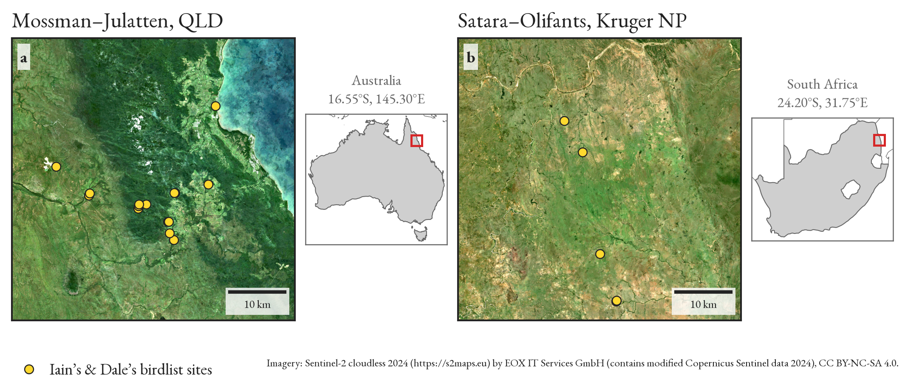
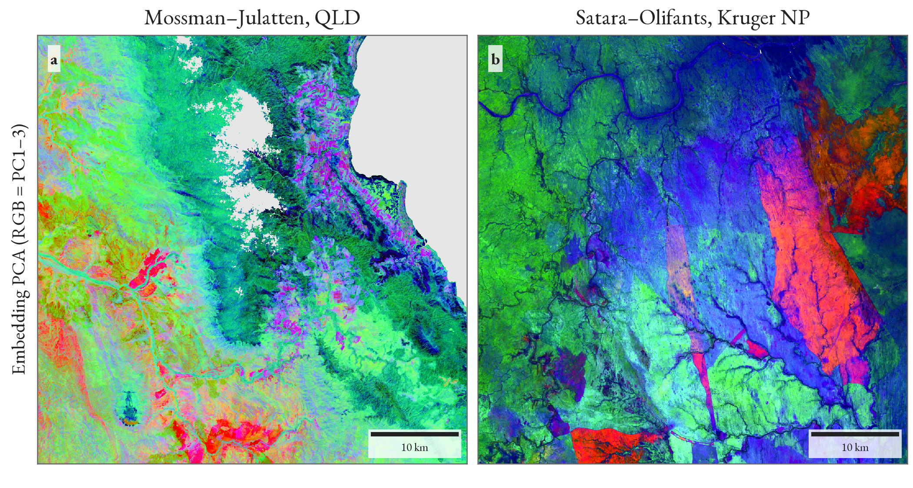
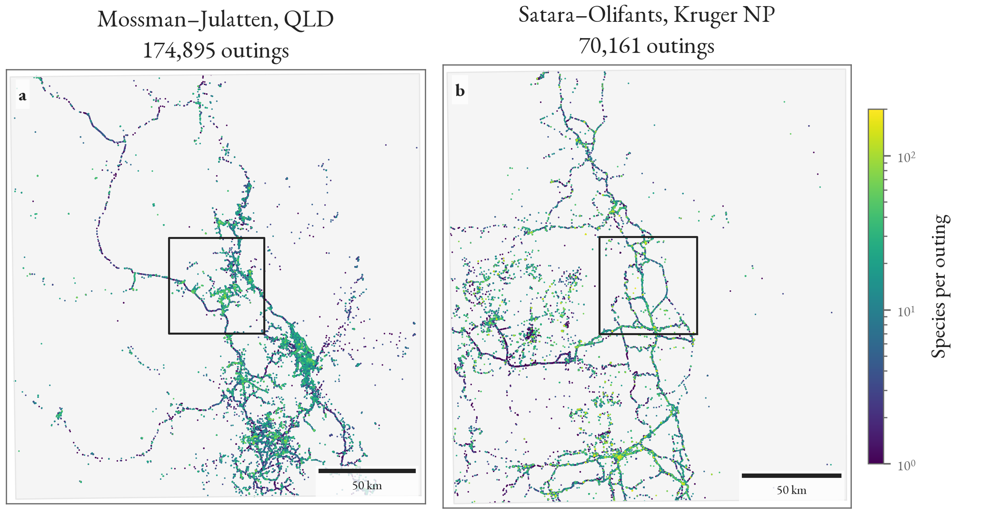
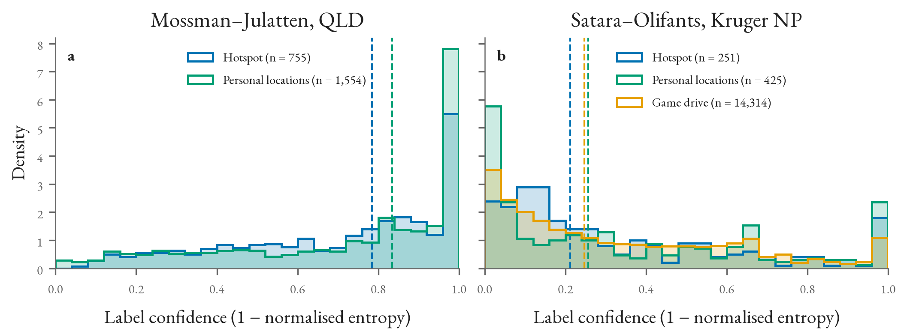
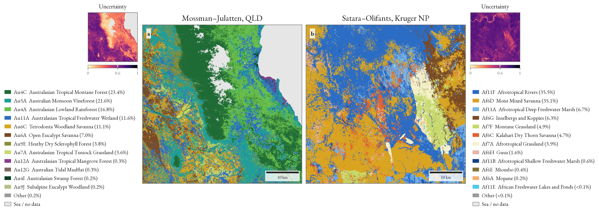
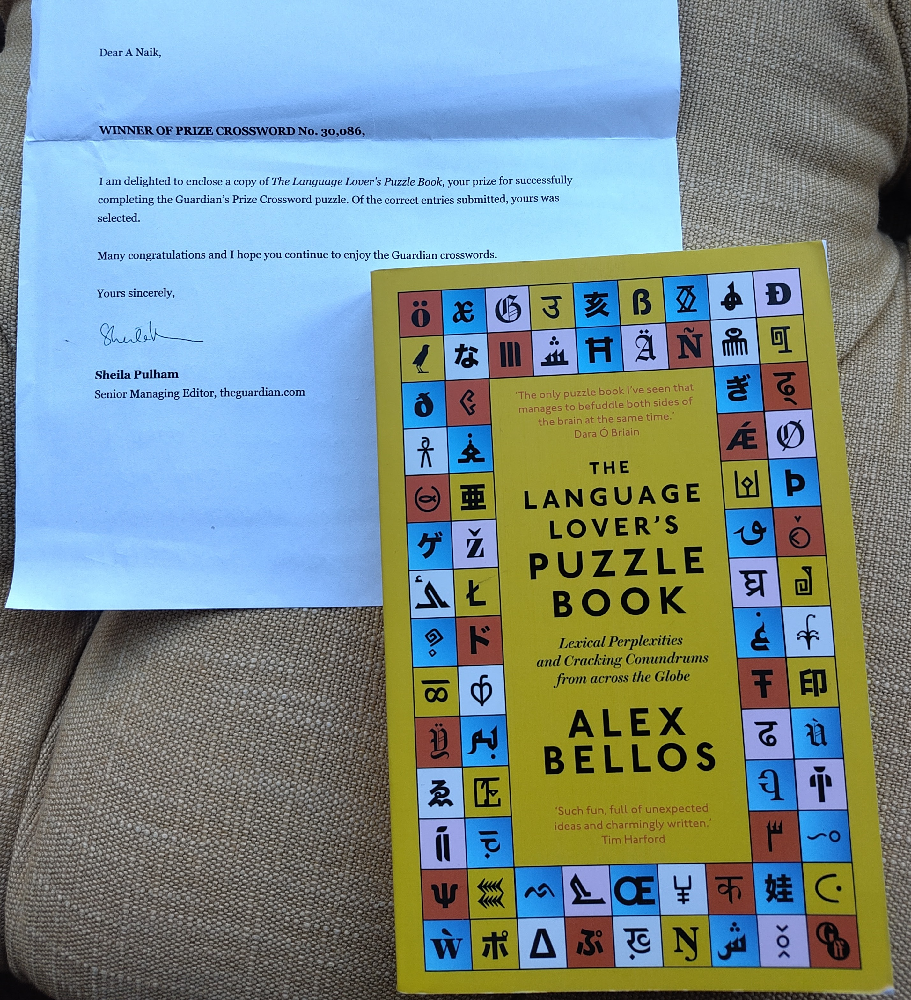

## Bird-based Habitat Mapping

In my [previous post](20261028_weeknotes_2026_43.qmd), I described my work mapping habitats using eBird data. I've finished a run at the pipeline, written up a report, and shared it with my collaborators. I'll summarise my findings here.

{fig-align="center" fig-alt="Two satellite images side-by-side." width="100%"}

The figure above shows satellite imagery of the two 50x50 km sites I mapped, one in Australia (northern Queensland) and one in South Africa (Kruger National Park). The yellow points represent a small handful of 'ground truth' points that I'll use to validate my map later on. In both places (Kruger in particular), this is far too limited a validation to be considered robust. I'm just using these points to give me a very first indication of map quality, alongside visual inspection of the maps. My collaborators, who collected these points, know the areas intimately.

{fig-align="center" fig-alt="Two brightly coloured false colour maps side-by-side." width="80%"}

The figure above shows a false-colour image of the [Tessera](https://geotessera.org/) embeddings over the same sites. I use these embeddings as covariates in my habitat classification model.

{fig-align="center" fig-alt="Maps of eBird checklists over two sites." width="100%"}

The figure above shows the points I use to train my habitat classification model: eBird checklists in the 200km box surrounding each site. There is a problem that is apparent from the outset: the checklists are tightly clustered around the road network, particularly in Kruger.[^fanshawe] Not visible in this figure is a second problem, just as troubling: the checklists in Kruger are nearly all "traveling" [sic] checklists, taken over the course of a long (often >100km) drive. 

[^fanshawe]: As my colleague John Fanshawe put it: they don't let you out of the car in Kruger so that you don't get eaten.

{fig-align="center" fig-alt="Graphs showing label confidence over two different sites." width="100%"}

I created a procedure for assigning "soft" habitat labels to each checklist. In other words, each checklist is not assigned a single hard habitat classification, but a probability distribution over habitats. This figure shows the distribution of label confidence across the checklists (a label is *confident* if the probability distribution is narrow, i.e., most probability is assigned to only one or two habitats). Because of the problems I noted above, we have much cleaner labels in Queensland than Kruger.

{fig-align="center" fig-alt="Two maps of habitat classifications." width="100%"}

Having assigned these soft labels and used them to train a habitat classifier, here are the maps the trained model generates across both sites. The map seems largely reasonable in Australia, and the classifications are confident (see the uncertainty thumbnail) across most of the site. Comparing with the handful of validation points, the map correctly classifies 10 of 15 of them.

In Kruger, very little of the map is confidently classified, and *none* of the validation points are correctly predicted. We'll have to think of something smart to do here!

## UK Plant Maps

Over the last several months I've spent a bit of time developing a multi-species plant distribution modelling pipeline using Tessera, benchmarking it against the [GeoPlant](https://arxiv.org/abs/2408.13928) dataset (10k species across Europe). I'm writing up the results of those experiments into a manuscript, but at the same time I've turned the firehose on the UK: I took my "best" model, trained it on some citizen science data, and made a first 'shoot from the hip' pass at some GB-wide plant maps. They're looking quite encouraging, but I will wait until a slightly more mature version before sharing visuals here.

After I've matured these maps a little, the plan is to feed them into some actual *science*. That is, understand habitat change and the causes behind it.

## Miscellanea

### Crossword Prize

I have submitted maybe 80 completed entries for the Guardian's weekly [Prize Crossword](https://www.theguardian.com/crosswords/series/prize) competition. They draw five names out of a hat each week, and the chosen winners receive a prize in the post. Last week I *finally* got a prize![^prize] *Après avoir vu ça, on peut mourir tranquille.*[^roland]

[^prize]: This actually is for an entry I sent in August. The prize sat with a neighbour for two months before they posted it through my letterbox.

[^roland]: It is perhaps a little unlike me to make [oblique football references](https://en.wikipedia.org/wiki/Thierry_Roland). I once had a French colleague who, very memorably, used to utter this quote whenever anything nice happened to him.

The prize, pictured below, is *The Language Lover's Puzzle Book* by Alex Bellos (he of [Guardian Monday puzzle blog](https://www.theguardian.com/science/series/alex-bellos-monday-puzzle) fame). I thought this would be a book of *word puzzles*, but it turns out to be a book of *language puzzles*, along similar lines to a [linguistics olympiad](https://www.uklo.org/past-exam-papers/). Watch this space!

{fig-align="center" fig-alt="A photo of the Language Lover's Puzzle Book by Alex Bellos, and a congratulatory letter from the Guardian." width="55%"}

### Sheep Stanes

The week before last was my favourite week in the Edinburgh calendar: the (confusingly named?) [Scottish International Storytelling Festival](https://www.sisf.org.uk/). The theme this year was *Bird and Beast*. Alas, I didn't have time to go to many things this year, but a personal highlight was a performance called *Sheep Stanes* given by storyteller [Ailsa Dixon](https://www.ailsadixonstoryteller.com/). It was a wonderful hour of dark, brooding folk stories from North Ronaldsay deftly interwoven with Dixon's own funny and moving story of building a dry *stane* wall around the island.[^sheep] My wife and I agreed this was the best show we'd ever seen at the festival.

[^sheep]: The wall is so that the feral sheep of North Ronaldsay remain hemmed between the *groond* and the *watter*.
