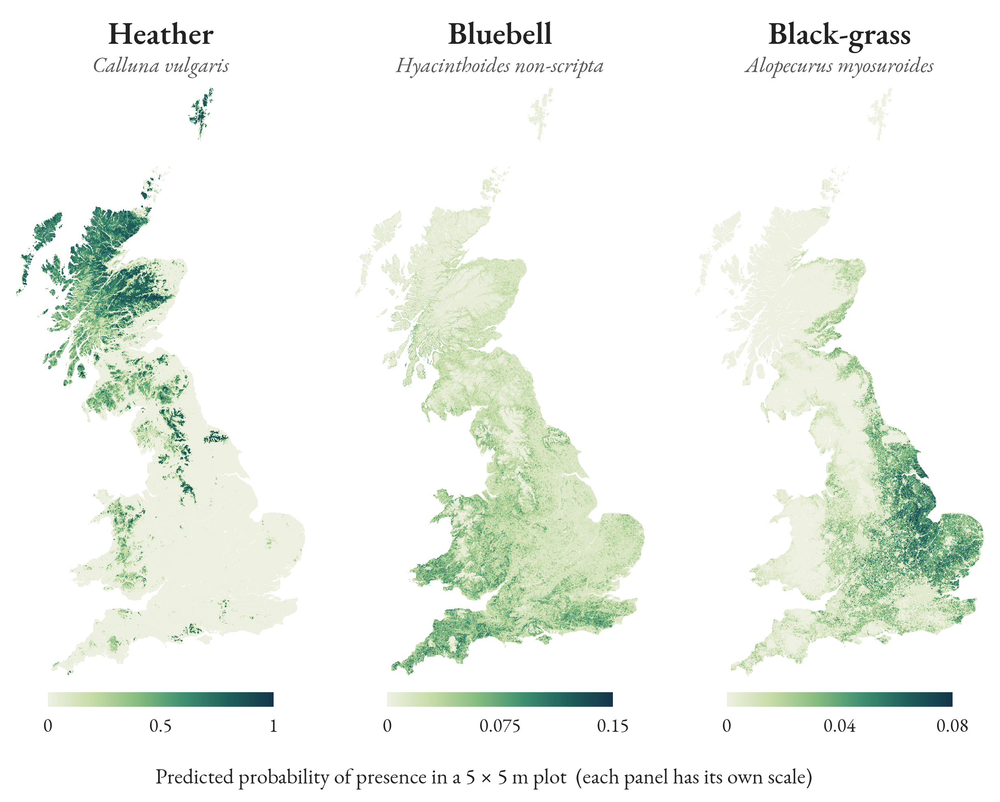
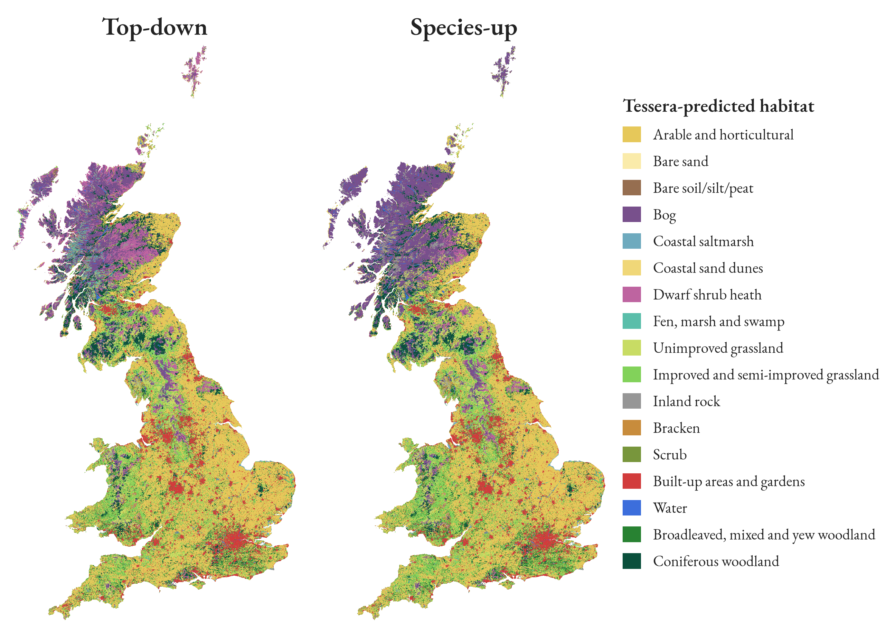
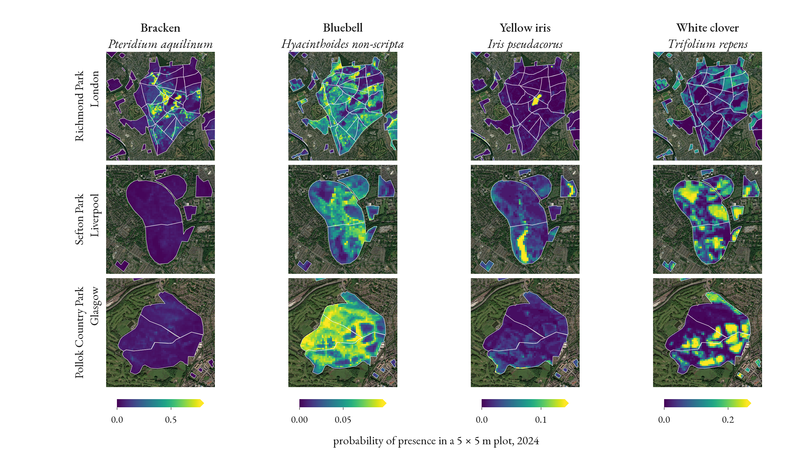

## Species and Habitat Mapping

I had a good couple of weeks on the species mapping and habitat mapping front. To summarise:

- Having previously claimed this a few times, I now truly have done my last species mapping experiments with the GeoPlant dataset. What I've come out with from this exercise is an understanding of how best to do species distribution modelling with Tessera.[^glc] I've put all my figures together into a manuscript, and I'm working on writing this up.
- I'm now turning this pipeline to the UK, building plant species maps using various datasets. One advance over my GeoPlant pipeline: I'm incorporating it into a *Bayesian* workflow, so that we get (hopefully well-calibrated) uncertainties on our species maps. I spent an extremely enjoyable day working out the theoretical framework for this.
- With a quick first pass at the pipeline, I've made species maps of 124 plant species across Great Britain. Here are some examples:

{fig-align="center" fig-alt="Three maps showing plant distributions of three species." width="60%"}

- With these species maps in hand, I then have a *plant assemblage* at each pixel. Using some labelled habitat polygons, a model can then learn an assemblage-habitat link, and make a habitat map. I have access to a large number of such habitat polygons: the ground-truth polygons used to create the [Living England](https://defraenvironment.blog.gov.uk/2024/12/18/living-england-a-national-habitat-map-for-everyone/) habitat maps. Using these polygons, I made two habitat maps: one using this *species-up* approach, and one with the conventional *top-down* approach (i.e., simply training a habitat classifier with remote sensing covariates). The figure below compares the two maps.

{fig-align="center" fig-alt="" width="80%"}

- The agreement between the two maps is rather good, despite the differing methodologies / philosophies.[^gleason] This is encouraging, because I much prefer this (unconventional) species-up approach for two reasons. First, it aligns better with a more ecological understanding of *habitat*. Second, with this kind of approach, one is able to map a little more *fuzzily*, i.e., look at how species assemblages vary spatially and use this to map more spatially gradual boundaries between habitats.

I haven't yet turned on the Bayesian switch. Will experiment with that next week!

[^glc]: In particular, I've built a pipeline for plant SDMs with Tessera that would have won the 2024 GeoLifeClef competition.

[^gleason]: [A few months ago](20260605_weeknotes_2026_23.qmd) I wrote a little about the Clementsian versus Gleasonian philosophies regarding ecological communities. We can understand these top-down and species-up approaches to habitat mapping as being approximately Clementsian and Gleasonian respectively.

## UK Green Spaces

We got an enquiry last week from the British Trust for Ornithology about habitat mapping British "greenspaces" (urban parks etc.) using Tessera. Following this enquiry, I've been playing around a little bit with what my habitat/species maps looked like in these settings. Some examples below.

{fig-align="center" fig-alt="A 4x3 grid of maps: maps of four plant distributions across three UK parks." width="100%"}

I don't yet have a clear science goal for this work, I'm simply doing some exploration ahead of a meeting with the BTO this coming week.

## Crossword Corner

After the dizzying heights of [last month's crossword prize](20261111_weeknotes_2026_45.qmd), I've been on a bit of a comedown: the last couple of weeks have been relatively light on crossword *solving* front.[^postcard] On the other hand, I have recently gotten back into the practice of *writing* crosswords. I'm working on a themed crossword, and this is my favourite clue so far:

> Countertop hi-fi installation nine feet long (4)

Solutions to me. No prizes.

[^postcard]: However, I did receive a delightful crossword clue in the post (!) from my colleague [Sam Reynolds](https://www.samreynolds.org/). I would like to **strongly** encourage this kind of behaviour. Readers, take note.
